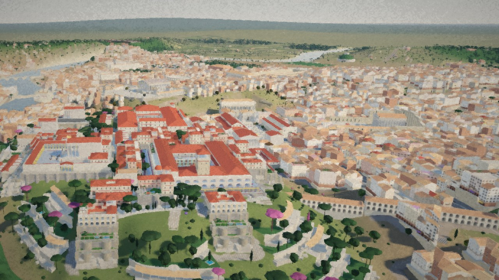

# Building Rome in One Day · 尼禄重工纪元罗马沙盘

**Rome wasn't built in one day — but you can build your city in one day.**

A 430k-character Chinese novel, 《尼禄重工纪元》, turned into a living 3D Rome that **changes with the plot**:
as the reader scrolls, buildings rise, building sites appear, and place names in the text fly the camera to the spot.
The project was made for the novel from the start.

| Folder | What it is |
|---|---|
| [`nero-rome-reader /`](nero-rome-reader%20/) | **The project:** the reading site with Rome, Antium, Ostia and the empire map. Code, Blender scripts, briefs, docs |
| [`novel2city/`](novel2city/) | **The skill:** the reusable Claude skill that builds a city like this from any novel. Start here to build your own |
| [`novel2city/examples/rome-day1.html`](novel2city/examples/rome-day1.html) | The city as it stood after **day one**, as a single HTML file |
| [`nero-rome-reader /docs/making-of/`](nero-rome-reader%20/docs/making-of/) | Making-of: measured token ledger per stage and per asset, video plan, blog outline |

Build and run: see [`nero-rome-reader /README.md`](nero-rome-reader%20/README.md).

The novel text and the reference images belong to their owners; see the licence notes in each folder.

## Licence

- Documentation: [CC BY 4.0](https://creativecommons.org/licenses/by/4.0/).
- Scripts and source code: MIT License.
- Novel and other text: © the author; all rights reserved unless the author states otherwise.
