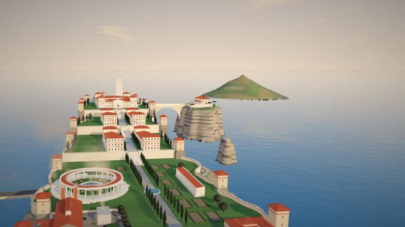

# 尼禄重工纪元 · 罗马沙盘阅读器 (Nero Rome Reader)

A reading site for the Chinese novel 《尼禄重工纪元》: the text on one side, a living 3D model of Rome
(and Antium, Ostia, the Empire in AD 58) behind it. As the reader scrolls, the city changes with the story:
nine states from AD 54 to after 68, chapter‑gated objects, paragraph triggers that move the camera, a resource bar,
and place names in the text that fly to the right spot.

* Three.js r147 (CDN), plain classic scripts, no bundler. The page is **one HTML file**; the Antium models
  (`antium-assets.js`) and the full text (`book.js`) are separate files it loads only when needed.
* Rome: ~200 named buildings (history and the book are labelled 【史】/ 书中), city fabric, seasons, night lighting.
* Antium: Nero's villa on a rocky headland that ends at the observation tower; functional zones on built terraces
  (gate and German guard barracks, lower garden, the narrator's cliff workshop, two palace tiers with sea galleries,
  the upper palace with the cloister and bronze altar, the summit court), the side-hall rock across the only bridge,
  the harbour and the town. Twelve core buildings are Blender models (`assets/models/antium/`).
* Ostia: harbour and slipways. Empire map (AD 58): provinces, cities, legion bases (AWMC data, ODbL).
* Reader: sample excerpts with sandbox cues, or the **full text** (目录 → a chapter) with previous / contents / next,
  the reading place remembered, links like `…/#ch12`, and optional per-chapter reader counts.
* Rome hero buildings: 50 Blender models (temples, palaces, the Circus Maximus, aqueduct terminals, rock outcrops…),
  compressed into `dist/rome-assets.js` and loaded after the page starts.
* Filters: 画意 (Kuwahara oil flattening), 轻晶格 (light crystal, **on by default**) and 晶格油画 (crystallized painterly:
  Voronoi facets + crossed brush dabs).



## Making of: Building Rome in One Day

The reader was built with the skill [`novel2city`](../novel2city/) (in this repository), which turns a novel into a
chapter-synced 3D city.

* **Day one:** the whole city stood after one day, using an estimated one or two 5-hour usage windows. That covered
  city models and historical sources, district densities measured from reference views, low- and high-density
  housing, temples, palaces, the reader and the story states. The day-one page is kept as
  [`novel2city/examples/rome-day1.html`](../novel2city/examples/rome-day1.html), a single file you can open directly.
* **The next two weeks:** refining assets, at roughly two weekly usage allowances (the author's estimate). That
  meant Blender hero buildings by worker agents, roads, facades, ground contact and float fixes. Measured from the
  session logs for 21–23 October: 1.12 B tokens processed by 44 agents (Opus lead, Sonnet integrators, Haiku Blender
  workers), about 94 % of them cache reads.
* Per stage and per asset, roads included, plus a video plan and a blog outline: [`docs/making-of/`](docs/making-of/).

## Quick start

```bash
npm install            # three (for local tests) and puppeteer
npm run build          # -> dist/index.html, dist/rome-assets.js, dist/antium-assets.js, dist/book.js
npm run serve          # http://localhost:8080 (use a server: the page loads book.js and antium-assets.js)
```

## Layout

```
src/shell.html                 page, CSS, HUD/reader/dock markup (the build injects the JS here)
src/core/renderer.js           renderer, sky, weather, seasons, time of day, post effects and filters
src/core/materials.js          city shader (roofs, walls, windows, night lights) and geometry builder
src/world/builders.js          temples, tholoi, courtyard blocks, porticoes, fountains, water
src/world/terrain-roads.js     Rome terrain, roads, bridges, city blocks
src/world/lots.js              house lots, narrow staggered houses, balconies, street porticoes
src/scenes/rome/monuments.js   named monuments, hills, aqueducts, infill, labels, camera views
src/scenes/rome/layers.js      story layers switched by state (and the Ostia scene)
src/scenes/antium/terrain.js   headland, terraces, side-hall rock, mainland, sea
src/scenes/antium/fortress.js  the villa by zone: terraces, walls, stairs, garden, wings, palace, summit, bridle path
src/scenes/antium/islet.js     the side-hall rock and the only bridge
src/scenes/antium/harbour.js   harbour, town, workshop yard, cliff-foot mill and water wheel
src/scenes/antium/main.js      layers, labels, camera views, GLB loader
src/ui/book.js                 full text: contents, chapters, reading place, reader counts
src/ui/app.js                  states, resource bar, reader, place-name links, triggers, pages, music
src/ui/empire.js               empire map overlay
data/                          density map, empire map data, book.txt (the full text)
assets/models/*.glb            Rome hero buildings (Jupiter temple, Domus Tiberiana, Curia), inlined in the page
assets/models/antium/*.glb     Antium core buildings, bundled into dist/antium-assets.js
assets/icons/                  resource icons (source PNGs; the page embeds them)
tools/build.mjs, check.mjs     build and syntax check
tools/test/                    headless boot test and view renderer
tools/models/                  Python generators of the Rome models
tools/models/antium/           Blender kit (bl_kit.py), one script per Antium model, optimize.sh
briefs/antium/                 modelling briefs (sizes, book quotes, checklists) and reference images
server/visit-counter/          optional Cloudflare Worker that counts readers per chapter
assets/models/rome/*.glb       Rome Blender models, compressed into dist/rome-assets.js (tools/glbopt.mjs)
tools/models/rome/             Rome kit (rk.py) and one Blender script per Rome model
briefs/rome/                   Rome modelling briefs, phase hand-offs (phase*.md) and reference images
docs/                          architecture, content guide, asset pipeline, TODO, screenshots
docs/making-of/                token ledger, video plan, blog outline
.claude/agents/                Claude Code subagent for Blender modelling
```

## The full text

`data/book.txt` is the novel. The build splits it at `第N章` lines, takes chapters up to `book.lastChapter`
(build.config.json), keeps the author's `【注】` notes, drops everything after them (drafts, working notes) and removes
`[cite: …]` markers. Volumes come from `book.vols`. To update the site, replace `data/book.txt` and build.

## Reader counts (optional)

GitHub Pages is static, so counts need a small service: see `server/visit-counter/README.md` (Cloudflare Worker + D1,
free tier, stores only salted hashes of IP addresses). Put its URL in `build.config.json` → `"counter"`. Empty = hidden.

## Tests

```bash
npm run build:test     # dist/test.html loads three.js from node_modules
npm run test:boot      # boots headless, prints the resource bar, fails on page errors
npm run test:shot -- '[[0,"forum",0.3,"forum.png"],[1,"antBridge",0.3,"bridge.png"]]'
```

## Deploy

`.github/workflows/pages.yml` builds on every push to `main` and publishes `dist/` to GitHub Pages
(enable Pages → "GitHub Actions" in the repository settings).

## Licences

* Documentation: [CC BY 4.0](https://creativecommons.org/licenses/by/4.0/).
* Scripts and source code: MIT License.
* Novel text (`data/book.txt`, excerpts in `src/ui/app.js`): © the author, all rights reserved unless the author states otherwise.
* Third‑party data: see `NOTICE.md`.
