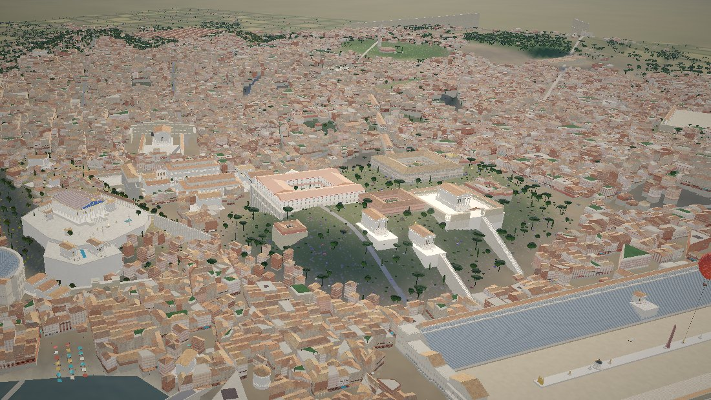
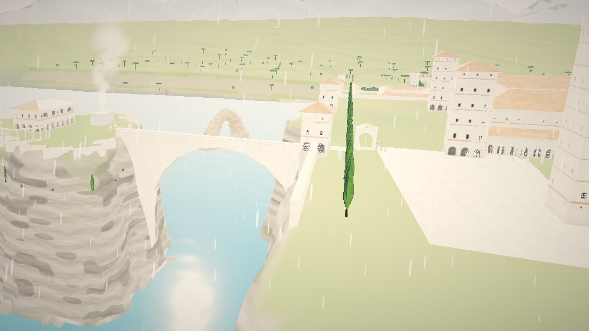
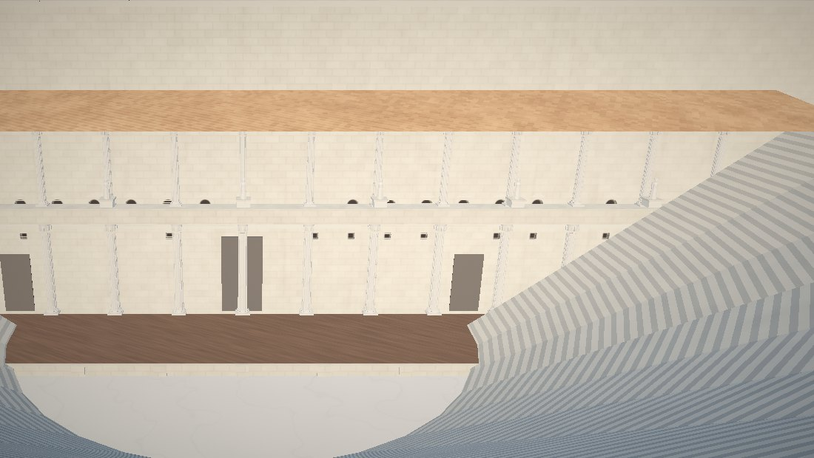
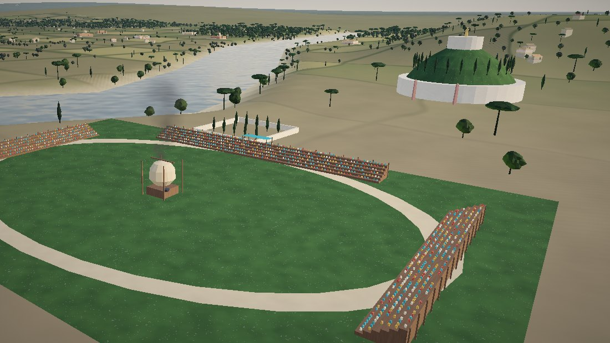
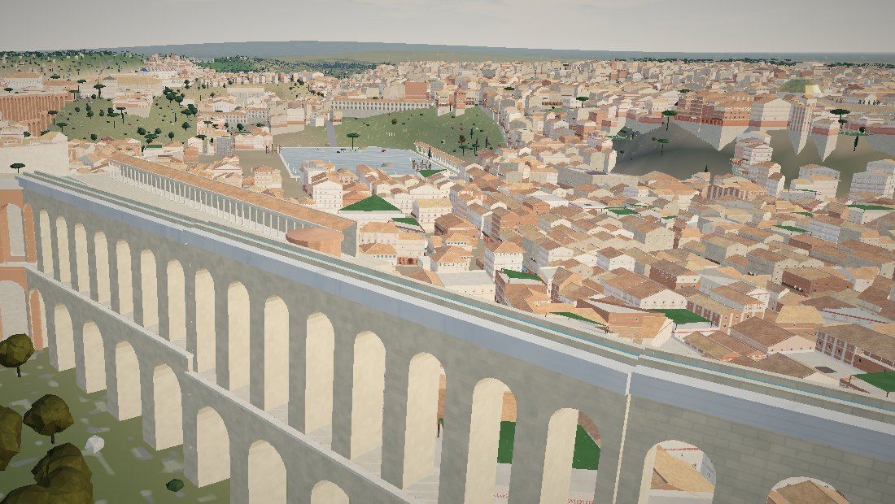
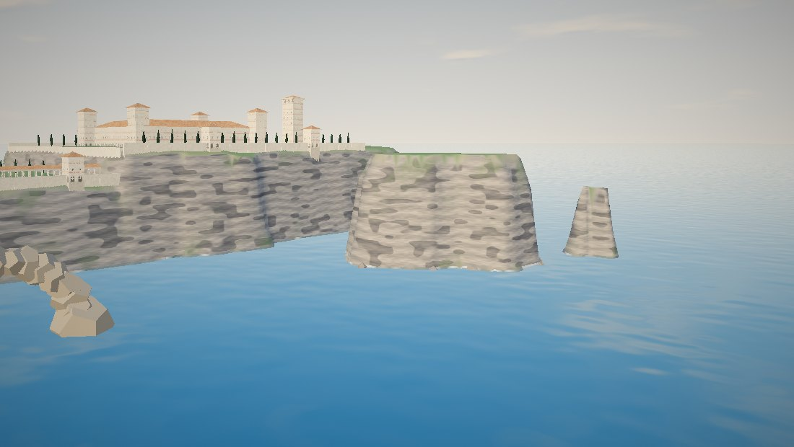

<h1 align="center">Novel2City · 把一本小说，读成一座会生长的 3D 古城</h1>

<p align="center"><b>写历史文、基建文的人，终于可以让读者"走进"你的城市了。</b><br>
一套经过真实项目检验的 Claude Skill：从手稿里抽出设定，到史料与参考图，再到一座随章节变化、能漫游的网页城市。</p>

<p align="center">
43 万字小说 → 公元 54 年的罗马 · 约 200 个历史地点 · 1.3 万地块 · 4 万棵树 · 9 个时代状态 · 581 处文字链接 · 3 个 GLB 核心建筑 · 20 多次迭代
</p>


| | |
|---|---|
|  |  |
|  |  |
|  |  |
|  | |

## 为什么需要它

- 读者看不出"那座宫殿在城市哪里""这座高炉有多大"。
- 让 AI 随手做一个 3D 场景，常常粗糙、没有时代感，还会把后世建筑放进来。
- 基建文的乐趣在于"城市一章一章地变"：高炉冒烟、铁轨铺开、玻璃窗越来越多。这需要数据驱动，而不是一张静态图。

## 九个阶段（每个阶段都有验收门）

| 阶段 | 做什么 | 详细说明 |
|---|---|---|
| P0 立项与镜头 | 先定 5–10 个"英雄镜头"和阅读布局 | [SKILL.md](SKILL.md) |
| P1 设定圣经 | 从手稿抽出时间轴、钱、资源、工程进度，打【史】【设】【书中】标签 | [01-story-bible](references/01-story-bible.md) |
| P2 地点与状态 | 1 单位 = 1 米的坐标表；把全书切成时代状态 | [templates](templates/) |
| P3 史料与参考图 | "不许出现清单"、六项打分、从鸟瞰图量密度 | [02](references/02-history-and-sources.md) · [03](references/03-reference-images.md) |
| P4 技术骨架 | three.js、图层 + 状态、章节闸门、段落触发、测试工具 | [04](references/04-tech-architecture.md) |
| P5 城市肌理 | 地形、道路、地标预留、窄楼错落、防重叠、防留缝 | [05](references/05-city-fabric.md) |
| P6 核心资产 | 任务书、四机位预览、主控 + 工人（Haiku）循环、GLB 进网页 | [06](references/06-hero-assets.md) |
| P7 光与天气 | 昼夜关键帧、季节、天气、古代夜景 | [07](references/07-light-weather-time.md) |
| P8 阅读体验 | 地名链接、触发、资源栏、面板分层、全屏阅读 | [08](references/08-reader-ux.md) |
| P9 质检与发布 | 34 个已知的坑、截图为证、拆仓库、自动部署 | [10](references/10-pitfalls.md) |

## 怎么用

1. 安装技能：把 `novel2city/` 文件夹放进 Claude Code 的技能目录（例如项目里的 `.claude/skills/`），
   或在 Claude 应用的设置里上传技能压缩包（以官方文档为准）。
2. 准备：小说全文（或分卷）、你最想让读者看到的几个画面、几张你喜欢的风格图。
3. 对 Claude 说，例如：
   - "用 novel2city，先帮我从这本小说整理设定圣经。"
   - "帮我给第三卷的港口找参考图，并按六项打分。"
   - "把我的城市做成网页，读到第 3 章时镜头飞到广场。"

## 多 agent 协作

| 角色 | 担任者 |
|---|---|
| 导演（审美与拍板） | 作者本人，或由顶级模型（如 Claude Fable）代理 |
| 主建造 | Claude Opus |
| 史学顾问（挑错） | 另一家模型（如 Gemini），所有意见都要出处、都要核实 |
| 文本编辑 | 小说编剧 agent：原句、章节、状态 |
| 建模工人 | Haiku 子代理 + Blender MCP |

## 最贵的十个教训

1. 1 单位 = 1 米，第一天定死。
2. 每个建筑先问"那一年它存在吗"。
3. 参考图先打分再用；后世的城市模型只借密度和质感。
4. 先给地标预留地块，所有生成器共用一张占地登记表——否则会有"上一版的建筑"压在新建筑上十几轮。
5. 墙体埋进地下，坡地加台基，桥加桥台——否则到处留缝。
6. 民居要窄、要错落；"八窗宽、六层高"的大方块像工厂。
7. 古代夜景是稀疏的油灯和火把，不是现代灯海。
8. 状态不够细，就用章节闸门和段落触发。
9. 截图为证；没看到图就说"还没确认"。
10. 代码早拆模块；一个常量用在定义之前，就能让整页起不来。

## 目录

```
SKILL.md                     主流程（Claude 先读这个）
references/01–12             各阶段的详细方法、坑的目录、案例、参考链接
templates/                   设定圣经、地点表、状态表、任务书、参考图打分表、链接审批表
scripts/                     参考图量密度、占地登记表、区域实例探针（scripts/tests/ 里有测试）
evals/                       测试用例、触发测试问句、第一轮测试输出
assets/screenshots/          本案例截图
```

## 致谢

本技能来自作者、Claude、Gemini 与小说编剧 agent 的一次长期协作。
借鉴：athenaion（参考图驱动的程序化古希腊世界）、bobeff/open-source-games（城建游戏）、
AWMC geodata（ODbL）、Natural Earth、Platner《古罗马地名词典》、斯坦福 Forma Urbis、皮拉内西数字项目。完整列表见
[references/12-sources.md](references/12-sources.md)。

## 许可

发布前由作者选择（建议：文档 CC BY 4.0，脚本 MIT）。小说引文版权归原作者。
